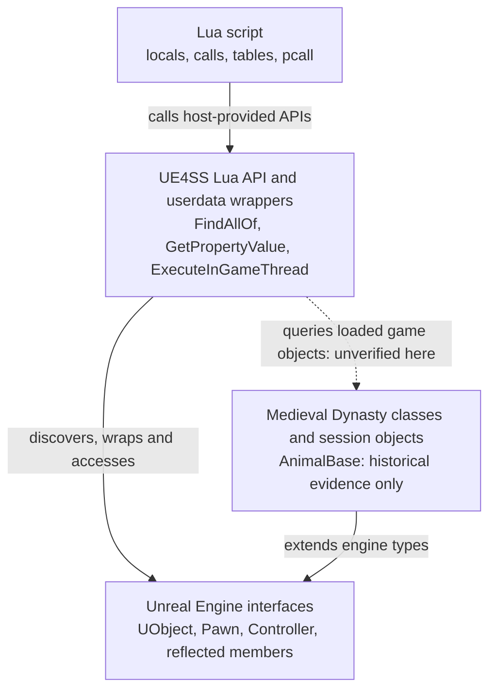
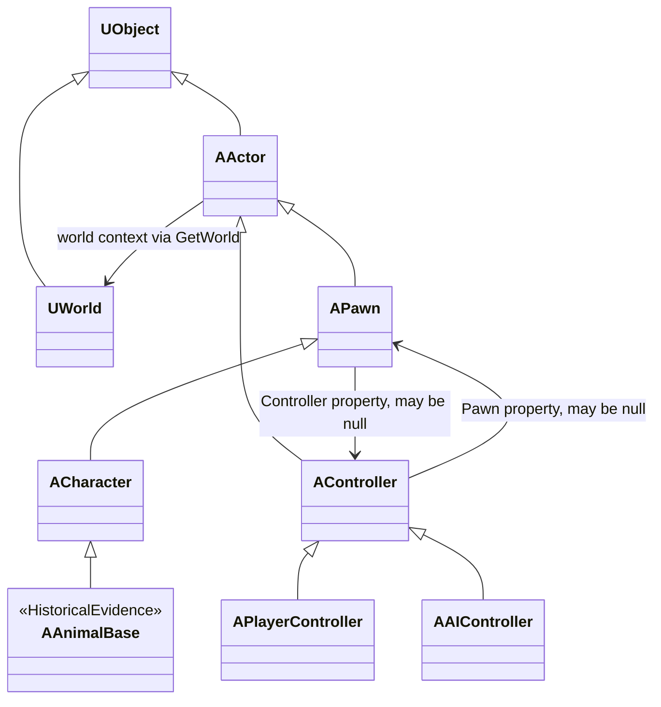

# Unreal and UE4SS mental model


Read an expression such as `animal:GetPropertyValue("Controller")` in layers:

| Layer | Responsibility here |
| --- | --- |
| Lua | Variables, call syntax, closures, conditionals and error protection |
| UE4SS | A Lua runtime inside the game process, object discovery, native wrappers, input binding and game-thread scheduling |
| Unreal Engine | UObject types, reflection, worlds, actors, pawns, controllers and their engine members |
| Medieval Dynasty | Game-defined animal classes and the concrete objects loaded in the current session |

The spelling `GetPropertyValue` belongs to the UE4SS binding. The property named `Controller` belongs to Unreal's Pawn class. The particular animal instance belongs to the game. This call crosses all three layers; labeling it simply “a Lua API” hides the useful distinction.



The arrows show API access and type relationships, not a stack of four independently running services. Lua locals hold wrappers; UE4SS mediates native access. A documented binding does not verify the game object selected through it. See [API provenance](../reference/provenance.md) for symbol-level evidence.

## Classes, instances and reflection

An Unreal **UObject** is an engine-managed native object. Its **UClass** describes its reflected type. `animal:GetClass()` returns a wrapper for that class object, whereas `animal` wraps an instance. `GetFullName()` describes an object's class/path/name for diagnostics; it is not a persistent identifier.

Unreal reflection exposes selected native declarations and Blueprint-generated members to engine tooling. C++ uses declarations such as UCLASS, UPROPERTY and UFUNCTION to participate in that system. UE4SS can discover and marshal that metadata; it does not turn every arbitrary C++ field or method into a callable Lua member. See Epic's [object handling](https://dev.epicgames.com/documentation/en-us/unreal-engine/unreal-object-handling?application_version=4.27) and the pinned [UObject binding](https://github.com/UE4SS-RE/RE-UE4SS/blob/236adf2667832375877669faac4b78872b4736b0/docs/lua-api/classes/uobject.md).

Conceptually, `GetPropertyValue` resembles reflection over a C# object's named field/property. The native representation and lifetime rules are different. Names are case-sensitive lookup inputs, marshaling can fail, and a private C++ reflected field may be visible even when no Blueprint getter is exposed. Generated SDK convenience methods named `M_Get…` are not automatically UFunctions callable from Lua.

There are two distinct kinds of method in an inspection script:

- `GetWorld`, `GetClass`, `GetPropertyValue` and `IsValid` are UE4SS-provided wrapper methods that use native engine facilities.
- `IsLocalController` and `K2_GetActorLocation` are engine methods reached through the binding's reflected-function dispatch. Historical SDK declarations corroborate these names; their successful use in a particular game build is unverified.

A **Class Default Object (CDO)** is a template containing class defaults. It is not a live placed animal. Archetype/template objects also need exclusion. An exclusion mask is one part of that filter, not a new engine concept.

## Actor, Pawn, Character and Controller

The standard framework relationships relevant here are:



Hollow triangle arrows mean **inherits from** and point toward the base class. Ordinary arrows mean **references/context**, not inheritance or ownership. The diagram omits unrelated engine classes and intermediate relationships. The engine relationships are documented concepts; the `AAnimalBase` extension is **historical evidence**, not a current-build class verification. The starter example does not require an `AAIController` subtype.

An **Actor** participates in a world. A **Pawn** is an actor that can be controlled/possessed. A **Character** supplies standard character movement/collision facilities; game animals can reuse it. A **Controller** directs a pawn and is itself a separate actor, not the pawn's base class. A PlayerController handles a human player's control. AIController is an engine subtype, but the starter example does not test whether an animal's controller is one. [Epic framework reference](https://dev.epicgames.com/documentation/en-us/unreal-engine/gameplay-framework-quick-reference?application_version=4.27)

At the instance level an inspection script expects:

```text
player controller -- Pawn property --> player pawn
animal pawn       -- Controller property --> animal controller
animal controller -- Pawn property --> same animal pawn
```

These are **relationships**, not inheritance arrows. The backlink confirms a consistent pair at the inspection point. It does not establish that a behavior tree is running, that the animal is biologically alive, or that the controller is safe to alter. The game-specific extension below ACharacter is recorded separately as [historical evidence](../reference/game-interfaces.md#animalbase).

## Worlds and locations

**UWorld** is a context containing levels/actors and gameplay state. It is not synonymous with a map's filename: loading, travel and engine activity can involve different world objects. Matching world pointers is more specific than matching map names. The inspection pattern anchors to the first usable local player controller/pawn pair and compares each animal/controller against that world.

`IsLocalController()` means local control in the engine's sense. It does not identify single-player mode; a local host or client can also have a local player controller. The external single-player check in the first-probe checklist is still required.

`K2_GetActorLocation()` supplies an FVector through the binding. `X`, `Y` and `Z` are struct components, not UObject properties on the animal. A distance-reading inspection pattern can compute straight-line squared distance in three dimensions and take one square root for display; the starter animal example does not measure distance. Dividing by 100 assumes conventional centimeter world units; it is not a game-specific calibration or a navigation/path distance. [Units reference](https://dev.epicgames.com/documentation/en-us/unreal-engine/units-of-measurement-in-unreal-engine)

## Userdata is a native boundary

Lua **userdata** can hold host-defined C/C++ state with metatable-provided operations. UE4SS uses userdata-backed wrappers to make native objects accessible. A UObject wrapper is neither a plain Lua table nor a managed C# instance owning a complete copy of an animal.

- `object:IsValid()` calls wrapper code, not a Lua language feature.
- `object.Field` can dispatch through a metatable into reflection.
- `a == b` for UObject wrappers uses UE4SS's underlying native-object comparison, rather than comparing diagnostic strings.
- A returned native struct such as FVector also crosses a marshaling boundary; it is not itself a UObject actor and should not be treated as one.

At the pinned revision the UObject `IsValid` implementation checks a non-null/non-sentinel pointer, membership in the tracked global object map, and that the object is not unreachable. That is more than a null test, but it is still not a lifetime lock or a gameplay-health check. [Pinned implementation](https://github.com/UE4SS-RE/RE-UE4SS/blob/236adf2667832375877669faac4b78872b4736b0/UE4SS/include/LuaType/LuaUObject.hpp#L763)

Unreal's garbage collection and actor destruction operate independently of the Lua local variable holding a wrapper. Do not treat such a local as a native ownership/rooting guarantee. The starter example keeps wrappers only during a scan and filters initialization/destruction flags before checking the relationship. A more detailed scanner could recheck the pair again immediately before logging. Those reduce avoidable misuse; they cannot make every native access safe. The [lifetime reference](https://dev.epicgames.com/documentation/en-us/unreal-engine/unreal-object-handling?application_version=4.27) describes Unreal's reference graph; it does not specify UE4SS wrapper ownership.

## Scheduling is not an await

UE4SS input callbacks should not be assumed to execute in a valid engine context for arbitrary object access. The inspection pattern requests a one-shot `ExecuteInGameThread` task using `EGameThreadMethod.EngineTick`. Think of a C# UI dispatcher/SynchronizationContext posting work to an owning thread, rather than a JavaScript promise returning a result. This is an analogy; the game thread is not a browser UI thread or the render thread.

The scheduling call returns before the inspection's eventual work. `EngineTickAvailable` is a UE4SS capability Boolean populated during mod setup, not an Unreal actor property or proof that a usable world exists. A pending task is not a recurring Tick callback. [Scheduling docs](https://github.com/UE4SS-RE/RE-UE4SS/blob/236adf2667832375877669faac4b78872b4736b0/docs/lua-api/global-functions/executeingamethread.md), [implementation](https://github.com/UE4SS-RE/RE-UE4SS/blob/236adf2667832375877669faac4b78872b4736b0/UE4SS/src/Mod/LuaMod.cpp#L4323)

Protecting queuing and the eventual inspection addresses two different error boundaries. A more detailed scanner could additionally protect each candidate, but the starter example keeps one inspection-wide protected call. Lua errors within those calls can be reported. A native crash, wrong layout or inaccessible memory is outside that promise of protection. If queued work never runs, a pending flag can remain set and further key presses do nothing. The starter example has no timeout or scheduler watchdog.

## What is and is not established

This is a source-level model for read-only inspection. No UObject identity, specific animal subclass, controller type, current property access, or class query has yet been runtime verified against the target build. Find the exact evidence classification for each name in [API provenance](../reference/provenance.md). Native object access, actual AI behavior, saving and multiplayer are different questions; the latter are outside this guide's probe.
