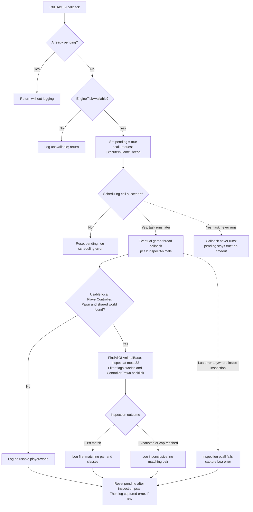

# One animal, one controller, one observation

This is a newly authored standalone example. **It has not been run in-game or validated against build 25776186.** Its class query is a historical lead, not a verified runtime discovery.

Review the [first-probe checklist](../getting-started/first-probe.md) before any execution. The documentation build includes this file as text and never evaluates Lua.

## Complete example

Source: [examples/animal-inspection/main.lua](https://github.com/rcarigna/medieval-dynasty-modding/blob/main/examples/animal-inspection/main.lua), licensed MIT. No DLLs or loader configuration are bundled.

```lua
--8<-- "examples/animal-inspection/main.lua"
```

## Inspection flow and failure boundaries

This flow follows the [published source](https://github.com/rcarigna/medieval-dynasty-modding/blob/main/examples/animal-inspection/main.lua). It describes intended control flow from static source inspection, **not a successful in-game run**. The `AnimalBase` query and resulting animal/controller pair remain unverified on the stated build.



The error branch denotes a failed inspection `pcall`; its message is printed **after** resetting `pending`. A scheduling error has its own protected-call boundary. Neither protects against a native crash, and successful queuing does not guarantee that the callback will execute. The candidate cap limits iteration, not the work done by `FindAllOf`. See [scheduling and lifetime](../concepts/object-model.md#scheduling-is-not-an-await) and [debugging](../getting-started/debugging.md).

## Read it in execution order

1. File loading initializes a private pending flag and an exclusion mask, defines the two helper functions, registers Ctrl+Alt+F9, and prints readiness. Defining `inspectAnimals` does not run it.
2. A manual key callback checks whether a scan is already queued and whether UE4SS reports EngineTick capability. It then protects the scheduling call with `pcall`.
3. The eventual game-thread callback protects `inspectAnimals` separately. A later callback error cannot be caught by a scheduling-time protected call. No recurring scan is registered.
4. `inspectAnimals` takes the first usable local PlayerController/Pawn pair sharing a world. Local control is not a single-player check; the chosen test context must be verified externally.
5. `FindAllOf("AnimalBase")` searches loaded candidates. The loop examines at most 32 results, rejecting templates, incomplete/destruction states and other worlds. The cap does not bound the search's own work.
6. For a candidate it reads inherited engine `Controller`, requires the controller's world to match, and checks whether its `Pawn` property points back to the candidate.
7. The first matching pair is printed with instance/class names. Otherwise the result is inconclusive. One Lua read error ends this small scan and is reported; there is no automatic retry or fallback class name.

## API quick reference

| Expression | Layer | Read more |
| --- | --- | --- |
| `local`, tables, loops, `pcall` | Lua language/library | [Lua guide](../getting-started/lua.md) |
| `RegisterKeyBind`, `ExecuteInGameThread` | UE4SS | [Bindings](../reference/ue4ss.md) |
| `IsValid`, `GetWorld`, `GetClass` | UE4SS wrappers over engine facilities | [Object model](../concepts/object-model.md) |
| `IsLocalController`, `Pawn`, `Controller` | Standard Unreal interfaces accessed through binding/reflection | [Unreal interfaces](../reference/unreal.md) |
| `"AnimalBase"` | Medieval Dynasty class-query lead | [Historical evidence](../reference/game-interfaces.md#animalbase) |

## Limits that matter

`canRead` is an inspection predicate, not “is alive.” Lua userdata is truthy even when a wrapper is invalid. The wrapper check and flags do not lock native lifetime or make C++ calls crash-proof.

This example is not a line-of-sight or nearest-animal selection. It does not require an AIController subtype, inspect a brain/behavior tree, or change behavior. It does not load assets, query save data or implement replication. Names are diagnostic, not durable IDs.

If queued work never executes, pending stays true. Lua errors can be reported; a native crash can still end the process. The world/backlink checks are sequential reads, not an atomic snapshot. Treat any useful result as one versioned observation, then follow the [evidence standard](../community/evidence.md).
